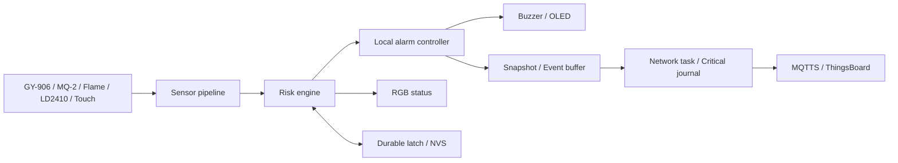

# Giám sát an toàn khu vực đun nấu

Firmware ESP32-S3 thu thập nhiệt độ, khí/khói, ngọn lửa và hiện diện để đánh giá nguy cơ tại thiết bị, điều khiển còi/OLED/RGB và gửi dữ liệu lên ThingsBoard qua MQTT TLS.

**Nền tảng:** ESP32-S3 N16R8 · ESP-IDF 6.1.0 theo lockfile · firmware `1.1.0-phase1` · data contract `schema_version=1`.

## Chức năng

- Đo nhiệt độ vật thể và môi trường bằng GY-906/MLX90614.
- Đọc MQ-2, cảm biến lửa và radar LD2410; gắn chất lượng và độ mới cho dữ liệu.
- Phân loại `UNKNOWN`, `NORMAL`, `SUSPICIOUS`, `WARNING`, `EMERGENCY`; trạng thái giám sát được đánh giá riêng.
- Chốt khẩn cấp được lưu NVS, khôi phục qua reboot; giải tỏa bằng nút cảm ứng tại chỗ khi đủ điều kiện.
- Còi, OLED SSD1306 và RGB phản ánh kết quả của bộ đánh giá nguy cơ.
- Tác vụ mạng tách khỏi vòng giám sát; có hàng đợi sự kiện, gửi lại và journal hữu hạn.
- Tách thông tin Wi-Fi/token vào cấu hình riêng không đưa lên Git.

Đây là nguyên mẫu nghiên cứu. Các báo cáo build/flash trước đây không đồng nghĩa toàn hệ thống đã được chứng nhận hoặc kiểm chứng vận hành thực địa. Phần tích hợp tenant, Rule Chain và dashboard cần nghiệm thu riêng.

## Bắt đầu

Chuẩn bị ESP-IDF phù hợp với `dependencies.lock`, kích hoạt môi trường ESP-IDF rồi chạy:

```bash
git clone git@github.com:phanmanhcuongdev/khu_dun_nau.git
cd khu_dun_nau
idf.py build
```

Repository đã chứa `sdkconfig` cho ESP32-S3. Lần build đầu tải các component vào `managed_components/`. Khi chưa có cấu hình riêng, firmware vẫn build để chạy giám sát cục bộ, mạng bị tắt.

Muốn bật kết nối, tạo cấu hình riêng:

```bash
mkdir -p private
chmod 700 private
cp tools/provisioning.example.json private/provisioning.json
chmod 600 private/provisioning.json
```

Điền `wifi_ssid`, `wifi_password`, `tb_access_token` bằng trình soạn thảo cục bộ. Sau khi đấu nối theo [bảng chân](docs/guides/hardware.md), build và flash vào đúng thiết bị:

```bash
idf.py build
idf.py -p /dev/ttyACM0 flash monitor
```

Thay cổng nối tiếp theo máy của bạn; thoát monitor bằng `Ctrl+]`. Xem [hướng dẫn build và cấu hình](docs/guides/getting-started.md) trước lần flash đầu.

## Sơ đồ phần cứng

[Ảnh sơ đồ breadboard](docs/hardware/so_do_khu_dun_nau_bb.png) · [File thiết kế Fritzing (.fzz)](docs/hardware/so_do_khu_dun_nau.fzz)

Xem ảnh và bảng GPIO tại [hướng dẫn phần cứng](docs/guides/hardware.md).

## Luồng xử lý



## Tài liệu

Bắt đầu từ [mục lục tài liệu](docs/README.md).

| Nội dung | Hướng dẫn |
|---|---|
| Môi trường, cấu hình riêng, build và flash | [Bắt đầu](docs/guides/getting-started.md) |
| Linh kiện, chân GPIO và bus | [Phần cứng](docs/guides/hardware.md) |
| Module, quyền sở hữu dữ liệu và persistence | [Kiến trúc](docs/guides/architecture.md) |
| Ngưỡng, trạng thái, mute và physical ACK | [Vận hành](docs/guides/operation.md) |
| Topics, lịch gửi, timestamp và Cloud routing | [ThingsBoard](docs/guides/thingsboard.md) |
| Host tests, schema và nghiệm thu thiết bị | [Kiểm thử](docs/guides/testing.md) |
| Chẩn đoán lỗi thường gặp | [Xử lý sự cố](docs/guides/troubleshooting.md) |

## Cấu trúc repository

```text
main/                 Điểm khởi động, drivers, pipeline, risk, alarm, network
components/rgb_status/ Component RGB và Kconfig
schemas/pccc-v1/       JSON Schemas và từ điển dữ liệu
fixtures/pccc-v1/      Payload mẫu từ serializer
migration/phase2/     Tham chiếu routing Cloud chạy dry-run
tools/                Provisioning, sinh contract và kiểm tra release
tests/                Host tests, stubs và kiểm tra schema
docs/                 Hướng dẫn, tham chiếu, review và báo cáo triển khai
validation/           Hình minh họa kiểm tra giao diện
```

`private/`, `build/`, `managed_components/`, khóa riêng, log và bằng chứng production sinh tự động được loại trừ bởi `.gitignore`. Không đăng firmware `.bin`/`.elf` đã provision vì có thể chứa thông tin kết nối.

## Kiểm tra nhanh

Với Python có `jsonschema`:

```bash
python3 tests/phase1/validate_contract.py
python3 tests/phase1/test_migration.py
python3 tools/release_check.py
```

Các lệnh này không flash và không ghi lên Cloud. Xem [kiểm thử](docs/guides/testing.md) để chạy các bộ C host tests và hiểu giới hạn của từng kiểm tra.
