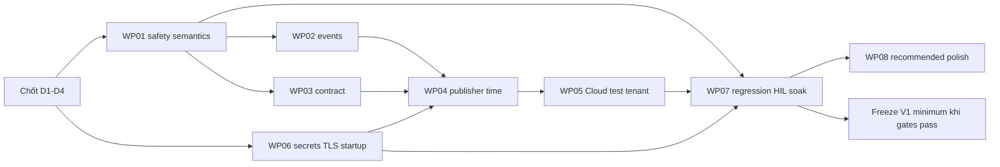

# PCCC V1 — Recommended implementation plan

[← Mục lục tài liệu](../README.md) · Chuẩn hóa tài liệu: **2026-11-12**.

**Trạng thái: tài liệu lịch sử — audit/đề xuất trước triển khai.** Những nhận định “hiện tại” bên dưới thuộc baseline lúc review; đọc [hướng dẫn hiện hành](../guides/architecture.md) và báo cáo Phase 1 để biết phần đã thay đổi.

Ngày: 2026-11-11. **Kế hoạch đề xuất, chưa được triển khai.** Dựa trên [audit/risk register R01–R18](production-readiness-review.md) và [ThingsBoard contract](thingsboard-data-model-proposal.md). Không thay ngưỡng phát hiện, không thêm remote ACK, không triển khai OTA/PSRAM như điều kiện mặc định.

## 1. Quyết định thực sự cần trước triển khai

| Decision | Đề xuất | Vì sao ảnh hưởng implementation |
|---|---|---|
| D1 — Latch và critical history qua reboot | Nếu V1 được triển khai không có người giám sát: persist emergency latch và bounded critical transition journal; chỉ physical ACK đủ điều kiện mới clear. Nếu chỉ lab: có thể chấp nhận reboot-reset, nhưng phải khai báo rõ và Cloud giữ incident chưa resolve | Hiện RAM latch/events mất khi reset; cần chọn policy trước thiết kế NVS và Cloud clear. Không mặc định power-cycle là ACK |
| D2 — Freeze cho lab prototype hay vận hành ngoài bench | Prototype có kiểm soát: release sau minimum gates. Không tuyên bố thay thế hệ thống bảo vệ chuyên dụng; DO/OUT không có supervision đầy đủ phải công khai | Quyết định mức chấp nhận R04 và threat model physical extraction; không bắt thêm chứng nhận |
| D3 — Contract và Cloud access | Duyệt flat schema1, read-only, publish10s NORMAL/2s abnormal, health60s/heartbeat30s, inactivity90s; xác nhận endpoint domain hiện tại tới tenant nào khi bắt đầu WP03 | Không đổi Cloud đang hoạt động trong review; kiểm tenant/quota bằng quyền có sẵn khi thực thi, không hỏi lại thông tin source đã có |
| D4 — Giới hạn mất dữ liệu và latency | Đề xuất event RAM32, in-flight4, outbox16KiB có thể hạ8KiB theo heap; không hứa vô hạn offline. Chọn deadline local D sau baseline đo, candidate2s trong fault envelope hữu hạn, không là guarantee hiện tại | Acceptance cần số đo và loss policy rõ. Nếu yêu cầu catch pulse ngắn hơn sample interval sẽ cần scope riêng GPIO latch/interrupt, không sửa thầm |

Duyệt sửa lỗi nhỏ trong Risk Engine (R01) phải tách khỏi việc đổi thuật toán/ngưỡng. Export detection/ACK eligibility/counter ở branch sẵn có chỉ read-only instrumentation. Không có đề xuất tự clear latch khi sensors về bình thường. Không cần thêm quy trình ảnh board: mapping R39/G38/B48 và chấp nhận onboard LED đã được user xác nhận.

## 2. Work package overview

Effort là engineering estimate cho một người quen repo, chưa gồm thời gian chờ hardware/tenant/24–72h soak; không là cam kết ngày giao. L/M/H là độ phức tạp tương đối.

| WP | Mục tiêu | Priority / release tier | Dependencies | Effort / complexity |
|---|---|---|---|---|
| WP01 | Safety-state correctness và physical ACK tests | P0/P1 — minimum | D1/D2, R01 reproduction | 2–4 person-days / M |
| WP02 | Event ownership/delivery reliability | P1 — minimum | WP01 event semantics; RAM fixes có thể làm độc lập | 2–4d / M |
| WP03 | Contract/schema + release identity | P1 — minimum | D3; WP01 read-only state exports | 2–3d / M |
| WP04 | Bounded async publisher/time/reconnect | P1 + P2 hardening — minimum phần delivery/time | WP02/WP03/D4, WP06 TLS clock agreement | 2–4d / M |
| WP05 | Alarm synchronization và dashboard | P1 minimum alarm path; dashboard refinement recommended | WP03/WP04, test tenant | 2–4d / M |
| WP06 | Credentials, TLS, startup failure containment | P1 — minimum | D2 threat model; phối hợp WP04 clock bootstrap | 2–4d / M |
| WP07 | Sensor integrity, runtime observability và production regression | P1 — minimum | WP01/02/04/06 fixes, hardware bench | 3–5d + soak elapsed / M–H |
| WP08 | UI/buzzer/release polish | P2 — recommended | WP07 measurement baseline | 1–3d / L–M |
| WP09 | Managed updates/hardware supervision | P3 — future scope | Nhu cầu deployment chứng minh | Chưa ước lượng, cần scope riêng |

Không cộng các estimate như lịch chạy song song đã được duyệt. Mỗi WP là patch reviewable riêng, không refactor toàn firmware.

## 3. Work packages chi tiết

### WP01 — Safety-state correctness / ACK and latch policy

**Scope:** R01, R08, R09; state observability tối thiểu cho schema. Giữ enum/threshold hiện tại.

**Affected:** `main/src/risk_engine.c:297–385`, `main/src/local_alarm_controller.c:45–55`, `main/src/touch_btn.c:50–78`, headers state, risk/controller tests. Nếu D1 persist: module nhỏ chuyên latch storage, startup NVS policy (`main/main.c:45`); không đẩy vào network code.

**Implementation boundaries:**

1. Chuyển probe recovery từ review thành regression test trước khi sửa. Reset recovery start khi bất kỳ interruption invalid/stale/not-safe làm mất chuỗi5s. Không reset latch vì fault/network/không còn lửa.
2. Test touch raw vs latched-edge; tách continuous debounced physical hold khỏi pulse latch cho mute; release re-arms, register ISR errors checked, atomic edge consume.
3. New read-only exports nếu contract duyệt: detection_state, ack_eligible, successful physical_ack_seq; không tạo second risk classifier. Counter tăng tại **successful clear**, không tại ack request API; chưa clear khi unsafe.
4. Persistence chỉ nếu D1 chọn: lưu set/clear theo transition, version+CRC; phục hồi latch trước hiển thị NORMAL, fail policy cho corrupt/full NVS; không xóa NVS tự động làm mất latch âm thầm. Không ghi mỗi sample hoặc mỗi hold tick.

**Deliverables:** focused patch + transition table + tests + clear persistence rationale.

**Tests:** NORMAL→WARN→safe2s→fault10s→safe; stale equivalent; safe→80–95°C→safe; simultaneous flame/temp; repeated fires/ACK cycles; tap pulses không thành hold; hold while unsafe/release/new press; sensor invalid khi latched; network disconnected; power-cycle state policy.

**DoD:** R01 không tái hiện; mỗi lần recovery đủ5s **liên tục**; physical ACK không bypass; mọi exported state khớp same evaluation. D1 trace được nghiệm thu, thresholds unchanged. HIL button/power cases cần log+stimulus record, không chỉ host PASS.

### WP02 — Event ownership, ordering and loss accounting

**Scope:** R02/R03/R07; giữ bounded RAM architecture, không đổi safety thresholds.

**Affected:** `event_buffer.c`, `event_buffer.h`, `tb_mqtt.c:242–258,75`, event detector trong main; nếu D1 durable journal thì adapter tại event ownership layer.

**Design:** claim/remove immutable ID, không “drop current highest” sau publish. Publish result chỉ là accepted; track bounded msg_id→eventID map, complete trên PUBACK; retry/expiry explicit, không mutex qua network. Main local actuation trước network handoff để mutex không delay còi. Include monitoring/latch/accepted ACK/mute transitions; failure không advance clean state như đã delivered; counters và eventual authoritative resync.

**Deliverables:** queue contract, invariants, overflow/drop report, unit test scheduling hooks.

**Tests:** INFO peek/FIRE insert/drop schedule đã tái hiện; multiple priorities; full32, allcritical buffer, duplicates; publish fail/PUBACK delayed/expired/out-of-order; disconnect mid-write; reboot nếu durable policy enabled; heap allocation failure.

**DoD:** Không xóa unsent FIRE trong deterministic interleaving; counters ghi mọi reject/evict/expiry; broker ACK xóa **đúng ID**; latest critical được resync sau overflow. Chứng minh local caller không block do socket và handoff bounded. Không tuyên bố exactly-once/database durability từ QoS1.

### WP03 — Cloud Data Contract V1 và release identity

**Scope:** R06 và phần R18; implement schema sau duyệt, không triển khai Rule Chain production trước fixtures.

**Affected:** `tb_mqtt.c:create_telemetry_json/create_event_json`, state snapshot/API read-only, CMake version/manifest, new serializer tests/docs. Giữ publisher policy tách WP04.

**Deliverables:** machine-readable JSON Schema (từ proposal, semantic checks bổ sung), seven scenario fixture groups, data dictionary versioned, client attributes builder, build_id/config_id manifest. Capture time là acquisition/evaluation, không serialize time. Legacy pseudo-MQ2/flame-raw không rename thành ADC.

**Tests:** all enum/reason; missing/invalid/stale/warmup; finite checks; AO valid vs mv_valid; legacy/scheme1 migration; string bounds/OOM từng cJSON add; timestamp true/false; schema optional forward keys; payload byte budgets.

**DoD:** Seven examples validate types/units/quality và được test tenant ingest đúng scalar keys; không freshen stale measurement, không ppm; successful physical ACK có provenance; version đọc được khi reconnect. Nếu detection_state chưa export thì omit và dashboard UNKNOWN, không giả metadata.

### WP04 — Publisher, time and reconnect policy

**Scope:** R03/R07/R14/R15(time); bounded outbox/inflight, decouple sample/publish cadence.

**Affected:** network task, MQTT callback, SNTP status/clock anchor module nhỏ hoặc API trong network; không sửa detection thresholds.

**Design:** explicit single owner network state, atomic/EventGroup transitions; CONNECTED wake immediate thay sleep tới60s; dùng library auto reconnect hoặc app owner, không hai scheduler. Normal10s/abnormal2s/heartbeat30s/health60s là publish policy, không sensor sampling. Full current resync trước historical replay; sequence immutable shared domain. QoS1 and dedup contract, retain0, bound memory by D4.

**Tests:** Wi-Fi absent/brokerblackhole24h; TLS handshake fail; auth reject; reconnect storms/jitter; sync initially absent then clock step forward/back; offline event sameboot vs previousboot, bounded queue drop. Measure bytes/key rate và heap largest block/min.

**Deliverables:** publish policy config and tests, broker/PUBACK fault scripts, counters, time trust policy.

**DoD:** FIRE enqueue/wake không chờ periodic10s; no socket in safety task; CONNECTED wakes <1s khi network không bị blocking transport; bounded memory dưới worst tested outage; stale/time-unsynced frames không masquerade current sample. Time validation coordinated with WP06, not TLS bypass.

### WP05 — ThingsBoard alarm synchronization and dashboard

**Scope:** proposed contract sections6/8/9, R06; chỉ thực hiện trong test tenant trước khi user duyệt promotion.

**Affected:** device profile, Rule Chain schema gate/dedup/order/archive, operational + engineering dashboard. Firmware không nhận RPC hay shared safety attributes.

**Deliverables:** exportable/versioned Cloud artifacts và migration/rollback script, ingress fixtures/results, endpoint/tenant/quota inventory (không secret), alarm lifecycle table.

**Tests:** current vs delayed replay; same-seq duplicates; independent boot sessions; two conditions same timestamp; warning escalation; latched inputs clear; physical ACK accepted; cloud ACK action; offline server-inactivity; reconnect NORMAL with historical FIRE; concurrent records through actual tenant queue settings; downgrade firmware legacy branch.

**DoD:** One active emergency per device/type; Cloud ACK không clear device latch; replay không clear/update current incorrectly; event history không overwrite same-ms incident; no alarm history deletion. Operational view masks invalid/inactive values, no ppm, no remote emergency controls. Customer role permissions tested. Migration backup trước mọi production Cloud change, chưa có thay đổi nào ở review này.

### WP06 — Security/configuration and startup containment

**Scope:** R05/R10(startup)/R13/R15; không tự bật secure boot/flash encryption/eFuse hoặc đổi PSRAM.

**Affected:** Wi-Fi/TB provisioning headers/build config, TLS/time bootstrap, startup error handling, optional-driver initialization cleanup.

**Deliverables:** sample config không secret + per-device provisioning procedure ngoài tracked source, redacted logging, release security checks, failure status reporting. Pin/reuse `dependencies.lock` (hiện MQTT1.1.0, cJSON1.7.19~2, SSD1306 commit pinned) và toolchain6.1.0; manifest wildcard không được làm mất lock khi clean build.

**Tests:** source/binary-distribution/log secret scan; invalid token/device identity; revoked CA/wrong-host/expired/future cert; boot clock absent then sync; network init OOM/error không panic local safety; OLED/RGB init fail vẫn local loop; init retry không leak (hoặc document init-once unsupported retry).

**DoD:** không secret thật trong repo/report; cert tests reject rõ; offline safety không phụ thuộc time/TLS; known-good clean build from locked dependencies. Nếu accept physical extraction risk ở V1 lab, ghi rõ thay vì burn eFuse mặc định; deployed artifacts shared trước đó cần credential rotation theo phạm vi exposure.

### WP07 — Sensor integrity, runtime health and release qualification

**Scope:** R04/R10/R12/R17, test coverage còn thiếu; giữ primary sensor semantics trừ sửa integrity được duyệt.

**Affected:** MLX PEC validator, pipeline last-success/freshness/filter-reset policy, health instrumentation, tests/bench harness; minimal watchdog progress contract.

**Deliverables:** PEC test vectors theo Melexis, unplug/invalid/stale matrix, safety loop latency và task/heap/stack metrics, release test report; supervised bench stimuli không tạo lửa/khói nguy hiểm.

**Tests/measurements:**

- Firmware unit/integration: every reason và multi-condition primary precedence; median recovery chronology; MQ warmup/rapid-rise combinations.
- HIL: pull MLX/OLED I2C, stop radar UART + OUT combinations, disconnect Flame/MQ2 DO/AO separately; xác định những disconnect không thể detect bằng wiring hiện có.
- Log/CPU/network stress và delayed esp_timer; critical response deadline D; injected safety progress stall phải được watchdog phát hiện dù idle vẫn chạy.
- Min heap/largest block/stack HWM lúc TLS handshake/reconnect, cJSON allocation failures, queue saturation. Chỉ cân nhắc PSRAM nếu measurement chứng minh nhu cầu.
- Power cut/restart/brownout matrix khi active/recovered latched/ACK/write journal; đúng D1 policy. Không clear latch vì reconnect.
- 24h minimum soak gồm periodic network faults/sensor recoveries/alarms trên safe bench, không chỉ idle uptime; 48h/72h recommended cho deployment dài hạn.

**Acceptance:** 0 unplanned reset/overflow/lost critical không có counter; no monotonic leak trong min/largest-block trend sau cùng workload; stack margin recorded và thống nhất threshold (candidate>=25% tại worst tested load, không chỉ boot); local max latency<=D trong fault envelope đã mô tả; toàn bộ expected faults giữ valid risk/latch behavior. Không equate finite test với unlimited guarantee.

**DoD:** test report with build/config IDs, environment, exact durations/fault injection method, observed vs not tested; all P0/P1 closed or justified decision exceptions appropriate to lab scope. Hardware supervision không giải được bằng firmware phải remain limitation/explicit D2 decision, không báo software PASS giả.

### WP08 — Presentation/output and release polish (recommended)

**Scope:** R11/R16/R18(release docs), P2 filter recovery nếu chưa xử lý WP07.

**Affected:** buzzer timing scheduler only (decision logic untouched), OLED transfer result/cache or periodic resend, lifecycle init/cleanup, release docs.

**Deliverables/tests:** logic analyzer300/400ms warning,100ms fault beep under load; EMERGENCY continuous và no mute; OLED unplug/replug refresh; retry rate bounded/no spam; optical OLED readability user-confirmed; release packaging/USB recovery checklist. Buzzer scheduler có thể dùng mechanism nhỏ hiện có, không rewrite all tasks.

**DoD:** UI failure không affect safety timing; command phase/demand phân biệt; same immutable state sources; release notes honest về P2 limitations còn mở. Không cần redesign RGB đã hoạt động.

### WP09 — Future roadmap, không block prototype V1

- OTA signed images/rollback **chỉ** khi deployment cần remote maintenance; single-slot hiện tại được chấp nhận với USB recovery/downtime đã ghi rõ.
- Secure boot/flash encryption theo physical-access threat model; eFuse irreversible cần task và rollout riêng.
- Hardware DO/OUT supervision, nguồn dự phòng/circuit self-test nếu muốn triển khai bảo vệ thực; không bịa chẩn đoán từ GPIO đọc được.
- Fleet-scale storage/event durability, quota optimization sau số liệu usage. Không bắt framework mới, MQTT5, external broker, event bus lớn hoặc PSRAM.

## 4. Recommended execution order và dependencies

1. Reproduce/pin R01/R02 before fixes, then WP01 and WP02 focused patches.
2. WP06 provisioning/TLS/startup có thể làm độc lập khỏi schema; WP03 contract sau approve semantics exports.
3. WP04 bounded sender/time policy trước WP05 live rules; Cloud guard/archive test trước migrate current devices.
4. WP07 chạy unit/integration thường xuyên; full soak với final release candidate sau các patch cần thiết. Một lần build PASS không đóng gate.
5. WP08 theo rủi ro/measurement; nếu âm thanh/UI là phần cam kết V1 cần đúng timing/recovery thì promote liên quan thành minimum trước freeze. WP09 là quyết định sản phẩm sau này.

## 5. Release checklist có thể nghiệm thu

### Minimum Production V1 prototype

- [ ] Freeze input specification: thresholds hiện tại giữ nguyên, D1 latch power-cycle, D2 scope, D3 data contract, D4 memory/deadline.
- [ ] Regression tái hiện R01/R02 fail trên old source, pass trên fixed source; repeated ACK/pulse tests pass.
- [ ] Event completion đúng ID/PUBACK; queue/outbox bounded; all loss paths count; replay không rollback current alarm.
- [ ] MLX PEC, timestamp/freshness và sensor health semantics pass; document unsupervised DO/OUT limitations.
- [ ] No source credentials; TLS CA+hostname+validity cases tested; offline startup không block/abort local loop.
- [ ] JSON/schema examples ingest đúng ThingsBoard test tenant; dashboard masks invalid/offline; operator ACK khác physical ACK.
- [ ] Hardware tests for detector/alarm/latch with safe stimuli and actual button; no automatic clear by network/sensor recovery.
- [ ] Deadline, watchdog, heap/stack margins and24h soak recorded; 48/72h status explicit, not assumed.
- [ ] RGB enabled mapping39/38/48, RGB selftest production off; OLED/sensors/network regression pass; PSRAM unchanged unless approved evidence.
- [ ] Build ID/config/schema/version, dependency lock and firmware hash archived; clean build verified; USB recovery understood.
- [ ] Production Cloud artifacts exported/versioned before migration; no destructive history reset; rollback compatibility documented.
- [ ] All P0/P1 owners/evidence closed; exceptions only if lab scope explicitly accepts operational limitation, not waiver for silently wrong safety state.

### Recommended improvements

- [ ] 48–72h fault-rich soak; OOM fault injection broadens beyond default paths.
- [ ] Buzzer accurate patterns and OLED reconnect cache repair.
- [ ] Engineering dashboard/ADC/radar details on demand, not constant logs.
- [ ] Maintenance runbook, physical feedback testing, credential rotation drill.

### Future, not implicit work authorization

- [ ] Remote OTA/security fuses/hardware supervision receive separate scoped approval.
- [ ] No cloud safety controls, no auto-latch-clear policy introduced by dashboard.

## 6. Review deliverables và handoff

Ba Markdown reports là toàn bộ thay đổi của review. Khi giao WP cho Codex, prompt nên chỉ rõ WP ID, D1–D4 decisions đã chốt, source evidence và acceptance ở trên; yêu cầu đọc lại source nếu branch thay đổi, không phải khảo sát lại kiến trúc từ đầu. Không triển khai bất kỳ WP nào chỉ vì báo cáo đã tạo xong.
