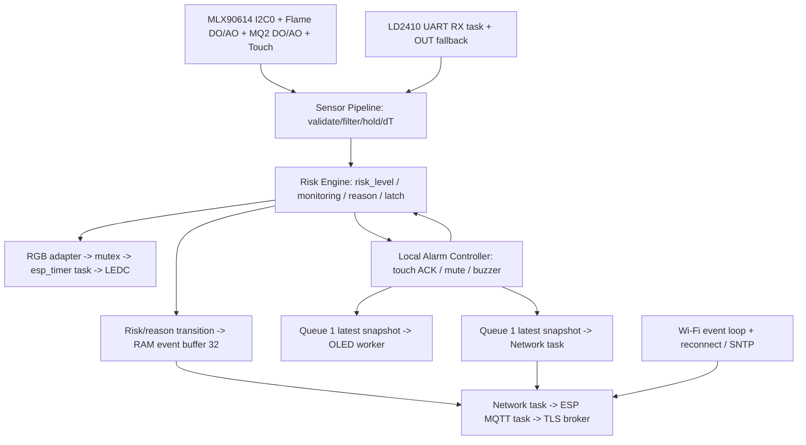

# PCCC V1 — Production readiness review

[← Mục lục tài liệu](../README.md) · Chuẩn hóa tài liệu: **2026-11-12**.

**Trạng thái: tài liệu lịch sử — audit/đề xuất trước triển khai.** Những nhận định “hiện tại” bên dưới thuộc baseline lúc review; đọc [hướng dẫn hiện hành](../guides/architecture.md) và báo cáo Phase 1 để biết phần đã thay đổi.

Ngày review: 2026-11-11 (Asia/Ho_Chi_Minh). Phạm vi: nguyên mẫu nghiên cứu ESP32-S3 N16R8, ESP-IDF 6.1, không đánh giá chứng nhận PCCC thương mại. **Chỉ review; không sửa firmware/config, không build/flash hay thay đổi Cloud trong vòng này.**

## Executive summary và verdict

**NOT READY để đóng băng Production V1; có thể tiếp tục demo/thử nghiệm có giám sát.** Đường cảnh báo cục bộ đã hoạt động và có tách OLED/network khỏi phần xử lý chính. Tuy nhiên, đã tái hiện lỗi thời gian phục hồi và mất event EMERGENCY do interleaving của event buffer. Data contract hiện tại chưa phản ánh đúng MQ-2, latch và timestamp. Credential trong source và thiếu thử nghiệm lỗi/soak là các gap trước release. Không cần refactor toàn bộ, bật PSRAM hay thêm OTA để khắc phục các vấn đề tối thiểu.

P0 dưới đây nghĩa là blocker của **hành vi lõi được thiết kế**, không phải tuyên bố đạt/không đạt chứng nhận. P1 phải xử lý trước freeze prototype production; P2 có thể chấp nhận có ghi rõ giới hạn; P3 để sau. Nếu dùng bảo vệ người/tài sản thay cho hệ thống chuyên dụng, bằng chứng hiện tại chưa đủ: không có chứng minh chẩn đoán đứt dây DO, độ phủ/hiệu chuẩn cảm biến, nguồn dự phòng hay thời gian đáp ứng worst case. Đây là giới hạn ứng dụng, không tự thêm yêu cầu chứng nhận vào V1.

## Bằng chứng và giới hạn

- Đọc toàn bộ source application `main/main.c`, 16 source modules, headers, RGB component, Kconfig/CMake, sdkconfig, test và validation logs; managed SSD1306/MQTT khi cần kiểm tra hành vi thư viện.
- Không có Git metadata (`git status` thất bại); không tạo repository. SHA256 source/config/tests trước và sau vòng review được đối chiếu; chỉ ba báo cáo trong thư mục này là đầu ra chủ đích.
- Đã chạy lại OLED ASan/UBSan, RGB host và bốn cấu hình LD2410: PASS. LeakSanitizer bị tắt theo test script do môi trường ptrace; không gọi đó là kiểm tra memory leak.
- Có thêm probe chỉ trong `/tmp/pccc-review-probes`, link source thật của Risk Engine/Local Alarm và event buffer; kết quả ở phần tái hiện. Đây là mô phỏng host, không phải HIL hay kiểm thử điện.
- Build/flash PASS trước vòng review có bằng chứng `docs/reference/oled-ui-v2.md`, `validation/oled_v2_boot_summary.log:1`, `validation/rgb_production_boot_summary.log:1`. Không chạy build mới để tránh tái sinh config/build artifacts. OLED optical chưa được xác nhận; người dùng đã xác nhận RGB đúng màu khi chủ động test.
- Cloud tenant, Rule Chain, quota, dashboard, broker reverse proxy/bridge không được truy cập: **UNKNOWN/NOT VERIFIED**. URI trong source là domain tùy chỉnh, không chứng minh tự nó là ThingsBoard Cloud trực tiếp.

## Kiến trúc hiện tại

`app_main()` là safety loop; sensor step -> risk step -> RGB -> event push -> Local Alarm -> telemetry (`main/main.c:118`). **Risk Engine là single source of truth cho mức rủi ro và latch**; monitoring độc lập trong cùng engine. Pipeline là nguồn chất lượng dữ liệu; controller là nguồn mute/còi/ACK vật lý. Không có cloud classifier hay RPC.

Khác biệt có chủ đích: RGB ánh xạ EMERGENCY > FAULT > WARNING; OLED và còi giữ WARNING trước FAULT (`main/main.c:125`, `main/src/oled_ui.c:51`, `main/src/local_alarm_controller.c:104`). Không phải ba bộ phát hiện cháy độc lập. OLED lặp điều kiện eligibility ACK để tránh prompt sai khi reason LATCHED bị giữ lại (`oled_ui.c:54`); nên export read-only eligibility từ engine về sau để tránh drift, không đưa ngưỡng lên Cloud.

### Module inventory

| Module | Hành vi thực tế / nguồn |
|---|---|
| MLX90614 | Hai I2C read 100ms, object/ambient cùng valid; bit lỗi và dải kỹ thuật; chưa kiểm PEC (`gy906_sensor.c:10,93`) |
| ADC shared | ADC1 oneshot, 12dB, calibration nếu khả dụng; AO độc lập khỏi input risk (`adc_shared.c:26,51`) |
| MQ2 | DO active-low; risk raw giả lập 200/1000 từ DO; AO thật đọc riêng (`mq2_sensor.c:68`) |
| Flame | DO active-low; raw legacy 4095/0; AO thật riêng (`flame_sensor.c:67`) |
| LD2410 | UART RX task duy nhất, framing/length/footer/semantic validation, critical section snapshot; OUT luôn valid fallback nếu init GPIO được (`ld2410_radar.c:382,583`) |
| Pipeline | Median nhiệt 3, average MQ2 pseudo-raw 3, dT/dt, hold, aggregate quality (`sensor_pipeline.c:112`) |
| Risk Engine | 5 risk enum, 3 monitoring enum, 14 reason; highest EMERGENCY latches; recovery hysteresis (`risk_engine.c:128`) |
| Local alarm | Hold ACK, 60s mute warning/fault, continuous EMERGENCY; OLED enqueue (`local_alarm_controller.c:29`) |
| Buzzer | GPIO40, patterns phụ thuộc gọi update ở loop, không task/timer riêng (`buzzer.c:88`) |
| Touch | ISR latch cạnh lên + polling; không phải đo độ dài xung liên tục (`touch_btn.c:50`) |
| RGB | R39/G38/B48; LEDC low-speed timer3/channel5–7 5kHz 8-bit; timer10ms; setters mutex (`rgb_status.c:62`) |
| OLED V2 | Pure model/render, worker priority1, queue1, changed-page I2C; worker owns display (`oled_display.c:19`) |
| Wi-Fi | WPA2 minimum, connect on every disconnect, wait IP 3s ở startup; `ESP_ERROR_CHECK` init (`wifi_app.c:19,41`) |
| MQTT | TLS CA, username token; app network task + library MQTT task, single latest queue, RAM events; no subscriber (`tb_mqtt.c:290`) |
| Event buffer | 32 static events, priority eviction/select, mutex50ms; separate peek/drop (`event_buffer.c:44,102,129`) |

## Detection / alarm / latch / ACK: cấu trúc thật

- `risk_state_t` chứa `risk_level`, `monitoring_status`, `risk_reason`, `emergency_latched`, `emergency_acknowledged`, countdown, evaluation time (`main/include/sensor_types.h:71`). **Không có detection-state enum tách biệt**. EMERGENCY bao gồm nguy hiểm hiện tại và lịch sử đã chốt.
- Current emergency predicates là local booleans `condition_fire` và `condition_critical_temp` (`risk_engine.c:143`), không export. Cùng lúc nhiều nguyên nhân: engine chọn fire trước critical temperature; warning chọn high-temp trước rapid-rise trước gas (`risk_engine.c:155,242`). Không có secondary-reasons array.
- Alarm output: `target_mode` trong controller; `buzzer_state` chỉ mức GPIO đang ON/OFF, không phải xác nhận âm thanh/hardware health. Intermittent alarm có thể đang OFF ở một pha dù alarm demand còn tồn tại.
- Latch: biến RAM static, set khi EMERGENCY; giữ ngay cả input hồi phục. Không network code nào xóa nó. `REASON_EMERGENCY_LATCHED` được set khi nhiệt hợp lệ <110°C và flame hợp lệ SAFE, chưa có ACK. Reason có thể tồn tại qua nhánh từ chối ACK (`risk_engine.c:175–220`); reason không đủ để suy ra current physical safe.
- ACK: controller gọi hold API sau risk evaluation. `ack_triggered` là request được API chấp nhận vào cờ RAM, **không phải latch đã clear**. Cờ `s_emergency_acknowledged` có thể bị xóa ở vòng tiếp theo khi danger còn tồn tại. Khi đủ điều kiện, branch clear đặt cờ lại false trước khi trả output; `emergency_acknowledged` không phải lịch sử accepted ACK đáng tin cậy. Reason ACK cũng có thể bị branch NORMAL/WARNING ghi đè trong cùng evaluation.
- Reboot/power loss: `risk_engine_init():20` đặt latch/ACK false; buffer init reset ID/count. Nếu nguy hiểm còn, vòng đo tiếp sẽ latch lại; nếu đã hết, lịch sử chốt mất mà không cần ACK. Quyết định persistence phải được chốt rõ, không tự áp đặt flash-journaling cho bản lab.
- Physical hold: thông thường release/repress có mẫu nhấn `<3s` làm re-arm; nghi vấn “ACK hỏng mọi lần sau” đã bị bác bỏ bằng probe. Tuy nhiên readout OR giữa mức pin và ISR pulse latch có thể biến nhiều tap rời rạc thành các mẫu state=1 liên tiếp; cần test đo liên tục, không khẳng định đã xảy ra trên thiết bị.

## Risk register / gap analysis

Evidence đường dẫn tương đối tính từ repo; số dòng là snapshot review này. Mọi fix dưới đây **chỉ đề xuất**.

| ID | Finding | Evidence | Risk / tác động | Priority | Proposed fix tối thiểu | Scope / ảnh hưởng | Acceptance criteria |
|---|---|---|---|---|---|---|---|
| R01 | Timer phục hồi không reset khi mất điều kiện an toàn/validity | `risk_engine.c:297–319,337–385`; probe R02 | WARNING/SUSPICIOUS có thể hạ NORMAL mà chưa có đủ 5s an toàn liên tục | **P0** | Reset recovery start ở mọi nhánh ngắt chuỗi safe, giữ nguyên threshold và physical latch | Risk Engine, cần duyệt thay đổi nhỏ + regression | Safe2s -> invalid10s -> valid không NORMAL cho tới đủ 5s safe mới; test cả STALE và temp80–95°C |
| R02 | peek/drop không định danh event | `event_buffer.c:102–156`, `tb_mqtt.c:246–254`; probe R04 | EMERGENCY mới vào có thể bị xóa thay event vừa gửi | **P1** | Claim/take atomically hoặc remove-by-ID sau success/ACK; không giữ mutex trong publish | event buffer + network, không algorithm | Deterministic INFO peek -> FIRE push -> complete INFO không mất FIRE; thread stress |
| R03 | Trách nhiệm lưu event kết thúc trước PUBACK; outbox không bound ở app | `tb_mqtt.c:249–254,75–77,308–318`; `mqtt_config.h:108`, `mqtt_client.c:729,2362` | Publish accepted != broker/server persistence; outbox expiry/reboot mất event, heap có thể tăng nếu không ACK | **P1** | Correlate msg_id với immutable event ID, bounded in-flight/outbox; expiry/overflow counters, retry/dedup | publisher + schema | Drop connection trước PUBACK, expiry>30s, OOM/backpressure: không mất critical âm thầm; local loop vẫn chạy |
| R04 | Sensor health tốt giả khi rút dây DO/OUT | `flame_sensor.c:75–90`, `mq2_sensor.c:76–91`, `ld2410_radar.c:620–625` | GPIO init/read success không chứng minh sensor connected; pull-up cho Flame/MQ2 có thể báo SAFE; radar mất UART vẫn overall valid | **P1** (giới hạn đã biết của prototype) | Export health/source riêng, test đứt dây; không tự biến mất UART thành không người. Đứt DO không thể chẩn đoán hoàn toàn bằng firmware hiện tại; ghi rõ hoặc đề xuất hardware supervision sau | sensor health/telemetry; algorithm không tự đổi | Unplug matrix ghi đúng UNKNOWN/unverified connectivity; dashboard không gọi GPIO-valid là sensor verified |
| R05 | Credentials literal trong headers; binary/NVS chưa encrypt | `main/include/tb_mqtt.h:10`, `wifi_app.h:5–6`; `sdkconfig:795,797,3494` | Rò source/binary có thể lộ token/Wi-Fi. Không có bằng chứng token bị dùng trái phép | **P1** | Per-device provisioning ngoài tracked source, redaction; rotate khi artifact đã chia sẻ; giữ TLS. Secure boot/flash encryption là quyết định threat model, không tự burn eFuse | config/build/provisioning | Scan source/log/report không có secret thật; clean build bằng provisioning ngoài repo; token từng thiết bị/revocation test |
| R06 | Data contract hiện tại nested/timestamp seconds, pseudo ADC và thiếu latch hiện tại | `tb_mqtt.c:94–219`, `mq2_sensor.c:87`, `main.c:158` | Dashboard có thể hiểu sai ADC/ppm, không truy vấn được key scalar hoặc dùng thời gian sai; stale events làm sai current status | **P1** | Flat keys + native ts(ms)/values; per-field quality, latch, boot/seq; migration Rule Chain trong proposal | serializer + Cloud sau duyệt | 7 fixtures ingest đúng scalar/time; không gắn ppm; backlog không làm current status lùi |
| R07 | Chỉ detect transition risk/reason; push lỗi vẫn advance previous | `main.c:145–173` | monitoring-only/physical ACK/mute không có event; event reject không được retry | **P1** | State vector gồm monitoring/latch/accepted ACK; bounded dirty-state retry; local actuation trước Cloud handoff | main adapter/events | Transition monitoring-only và ACK không mất; buffer full báo counter; FIRE không đợi telemetry interval |
| R08 | Latch và events không qua reboot | `risk_engine.c:20–28`, `event_buffer.c:23–25`, `main.c:45–50` | Power cycle có thể mất lịch sử/chốt; Wi-Fi/NVS init failure có thể reboot lại | **P1 decision gate** | Chọn rõ lab reboot-reset hay persisted critical latch. Nếu persistence: ghi theo transition, CRC/version, chỉ physical ACK clears; không ghi mỗi sample | startup/NVS/event lifecycle | Power-cut khi active và khi recovered-but-latched theo policy; NVS lỗi không âm thầm mất policy |
| R09 | ACK “hold” dùng state bao gồm pulse ISR; read/clear ISR flag không atomic; register ISR errors ignored | `touch_btn.c:33–35,60–63`, `local_alarm_controller.c:45–55` | Có thể mất cạnh hoặc nhiều tap thành hold giả; cần HIL xác minh | **P1** | Tách edge latch cho mute khỏi raw debounced continuous level cho ACK; atomic exchange/critical section; check init errors, giữ thao tác vật lý | touch/controller, không remote ACK | Tap ngắn lặp không clear latch; hold3s hợp lệ clear; release/repress, stuck pin và ISR fail test |
| R10 | Safety loop không có deadline watchdog, priority thấp hơn network; error init mạng có thể abort | `main.c:118–200`, `wifi_app.c:45–74`, `tb_mqtt.c:337`; sdkconfig2047–2057; IDF main priority1 | I2C/log/CPU pressure trễ cảnh báo; idle watchdog không phát hiện main task bị block/yield | **P1** | Đo latency, thêm task/user watchdog theo deadline đã chọn; fail-soft init cloud; chỉ đổi priority nếu đo chứng minh cần | scheduling/startup/observability | Broker offline, I2C timeout, log flood/OOM vẫn đạt deadline D được duyệt; watchdog detects stopped safety heartbeat |
| R11 | Còi nhịp300/400ms, fault100ms chỉ update mỗi~1s+processing | `buzzer.c:88–146`, `main.c:200`, `local_alarm_controller.c:129` | Nhịp thực bị lượng tử hóa ~1s; log buzzer_state không đại diện demand | **P2** | Pattern scheduler nhẹ riêng hoặc update theo timer/task hiện có phù hợp, không đổi quyết định mute/fire | buzzer timing only | Logic analyzer đo nhịp theo config trong jitter đã duyệt; EMERGENCY continuous và không mute |
| R12 | MLX đọc 3 byte nhưng bỏ PEC; filter không reset sau outage | `gy906_sensor.c:12–25`, `sensor_pipeline.c:138–161` | Sai dữ liệu vẫn trong dải có thể được nhận; hồi phục có thể trộn mẫu cũ | **P1** PEC; **P2** filter policy | Kiểm PEC, test lỗi bit; định nghĩa reset/refill filter khi mất valid; không sửa thresholds | MLX/pipeline | PEC mismatch không valid; recovery sample chronology/dT đúng và bounds |
| R13 | Partial initialization không clean, một số lỗi bị bỏ qua | `mq2_sensor.c:28–33`, `flame_sensor.c:28–33`, `oled_display.c:56–68`, `tb_mqtt.c:326–344`, `main.c:95–99` | Retry init có thể báo success khi AO chưa sẵn sàng; tài nguyên/network task partial sau OOM | **P2** | Separate GPIO/AO init flags, idempotent cleanup, startup health summary; log optional UI init failure, safety tiếp tục | init paths only | Fault injection tại mỗi allocation/API và init lần2; không leak, không giả ready |
| R14 | MQTT app backoff chỉ ngủ, không điều khiển reconnect thật; shared variables không sync | `tb_mqtt.c:20,27,69–81,230–239`, `wifi_app.c:24–30` | Reconnect do library fixed timeout; ngủ60s có thể trì hoãn backlog sau connected; data race bool/backoff | **P2** | Một owner reconnect, jitter bounded, event notification wake immediately, atomic/EventGroup state | network only | Reconnect wake <1s khi CONNECTED; không vòng retry kép/busy loop; task sanitizer/model test |
| R15 | TLS cert date check compile off; SNTP “synced” chỉ so year | `sdkconfig:3155–3159`, `tb_mqtt.c:35–59,308–316` | CA/hostname verified nhưng expiry/notBefore không được time-date check; chưa chứng minh clock đáng tin cậy | **P1** | Quyết định bật certificate date validation với bootstrap clock đáng tin, SNTP sync callback/status+age; test sai giờ và cert hết hạn | TLS/time config sau duyệt | Wrong-host/untrusted/expired/notYetValid cert reject; boot offline không tắt local safety |
| R16 | OLED cached pages cập nhật dù I2C API không trả lỗi | `oled_display.c:33–38`, managed `ssd1306_i2c_legacy.c:171–186` | Sau lỗi transfer, page không đổi có thể không resend; UI stale trong khi safety vẫn chạy | **P2** | Bounded periodic resend không clear hoặc expose transfer result/cache commit on success | display only | Disconnect/reconnect OLED tự refresh; safety cadence không đổi |
| R17 | Chẩn đoán đang bật và thiếu số đo tài nguyên/soak | `diagnostic_config.h:4–20`, `tb_mqtt.c:267–269`, sdkconfig2029 | Payload log+UART selftest mỗi boot, CPU/serial overhead; heap/stack margin UNKNOWN | **P1** evidence gate; log tuning **P2** | Release diagnostics profile; heap minimum/largest block/stack HWM/task timing, soak24h tối thiểu | tests/log config, no features rewrite | 24h có reconnect/fault cycles, không leak/reset; stack/heap margin ghi rõ; 48/72h recommended |
| R18 | Không có release identity/rollback OTA | CMake project không VERSION; sdkconfig960 single app; no OTA code | Không xác định build tái lập, cập nhật USB single slot có downtime; không rollback tự động | **P2** release ID; **P3** OTA | Version+schema/build hash+manifest, USB recovery procedure; OTA chỉ khi cần vận hành từ xa | build/docs, future OTA | Reproduce binary/version; USB recovery thử trên bench; không bắt V1 thêm OTA |

## Reliability và performance assessment

### Local independence và blocking

Sau khi loop hoạt động, MQTT offline không chặn publish ở main vì queue latest và network task riêng; OLED cũng có worker queue riêng. Tuy nhiên main push event có thể đợi mutex 50ms **trước** còi (`event_buffer.c:34`, `main.c:170–177`). RGB setter đợi mutex portMAX_DELAY; timer giữ mutex chỉ cho 3 update LEDC, không delay/network, nhưng không có worst-case timing proof. Shared esp_timer task chậm làm RGB nhịp sai/trễ; không đổi Risk Engine nhưng indicator không phải watchdog an toàn độc lập.

MLX I2C0 có hai timeout100ms liên tiếp; Flame/MQ2/ADC rồi risk evaluation theo thứ tự. Main `vTaskDelay(1000)` cộng processing, không `DelayUntil`: log OLED V2 khoảng1.04–1.13s ở trạng thái bình thường, không chứng minh upper bound khi lỗi. Fire DO không có ISR detection nên một pulse hoàn toàn giữa hai lần lấy mẫu có thể bị bỏ qua. Median nhiệt cũng thêm latency; chưa có detection-latency requirements đã duyệt. Startup sensor/driver init, beep100ms, Wi-Fi wait tối đa3s đều trước vòng evaluation đầu. Có timeout hữu hạn không đồng nghĩa không block.

Cấu hình: 160MHz, main stack3584/core0 (`sdkconfig:1933,2029`), main priority1 theo IDF `components/esp_system/include/esp_task.h:56`; network4096/priority3, radar4096/priority5, OLED4096/priority1; MQTT library mặc định stack6144/priority5 (`managed_components/espressif__mqtt/lib/include/mqtt_config.h:44–53`); esp_timer stack3584/core0, IDF timer task priority22. Ngoài ra có Wi-Fi/lwIP/event/idle tasks của IDF. Không tuyên bố một tổng task count runtime chưa đo. Comment network “priority thấp hơn safety” không khớp thực tế.

TWDT bật5s nhưng theo dõi idle cores, panic off; chưa thấy add main task/user heartbeat. Brownout detector bật level7; không có test sụt nguồn. Không có heap minimum, stack high-water, CPU-load telemetry. PSRAM disabled, hiện static buffers nhỏ (event32, radar stream1024, RX ring4096) và tasks dùng internal heap; **không có bằng chứng thiếu RAM cần bật PSRAM**. cJSON mỗi publish allocate/free nhiều node; serializer chỉ check root/tel/stat, chưa check mọi add failure => có thể partial payload dưới OOM. Giới hạn outbox + instrument trước khi đề xuất allocator mới.

### Sensor fault fidelity

GPIO quality chỉ phản ánh API đọc được; không là electrical supervision. Radar OUT fallback valid là chủ đích hiện có, UART invalid không tự làm UNKNOWN presence. Một dây OUT low bị đứt có thể bị coi không người. Không tự đổi fallback trong review. ADC AO validity tách khỏi DO quality; telemetry/risk legacy dùng DO-derived values. Dữ liệu “new_data”/last_update pipeline cập nhật kể cả read fail (`sensor_pipeline.c:128,175,231,271`), còn last-success chỉ giữ private; OLED freshness kiểm thêm quality; Cloud cần timestamps acquisition/last-success minh bạch. Nếu chưa từng có valid, chất lượng ở INVALID chứ không STALE — phải ghi rõ semantics, không bắt mọi failure luôn STALE.

Warmup15s là software timer, không phải bằng chứng MQ2 đã ổn định thực sự. Gas-only warning gated QUALITY_VALID và hold3s; rapid-rise+gas không kiểm MQ2 quality (`risk_engine.c:232–236`) nên có thể cảnh báo khi MQ2 warmup. Đây là hành vi cần xác nhận/characterize, không tự thay ngưỡng hoặc gọi nó lỗi đã duyệt.

### Security boundary

Có TLS mqtts/8883, root CA ISRG Root X1 (PEM openssl: hạn2035-06-04), không skip hostname trong app; không thấy token/password được log trực tiếp. Date-check gap R15 vẫn có dù CA auth hoạt động. Headers chứa credentials literal (giá trị không được sao chép vào báo cáo). NVS Wi-Fi lưu bật; NVS encryption/flash encryption/secure boot off. Physical extraction threat phải được quyết định trước khi triển khai ngoài bench, không tự burn eFuse.

Không subscribe, không MQTT_EVENT_DATA handler, không RPC/attributes apply/OTA: V1 hiện read-only cloud, đây là boundary tốt. Không cung cấp cloud route tới latch clear, mute emergency hoặc thresholds. USB update hiện có; thiếu OTA không là P0. Cloud dashboard ACK không được gọi firmware physical ACK.

### Flash/NVS/resource cleanup

Không ghi measurement/event thường xuyên xuống NVS; app gọi NVS init và erase khi NO_FREE_PAGES/NEW_VERSION. Wi-Fi driver NVS bật và set_config khi boot; actual write wear chưa đo. Không persist event/latch. RGB có deinit và pause timer/deconfigure channels; caller phải quiesce setters, lifecycle thread safety không được tự giả định. OLED/network/ADC không có full teardown; chấp nhận init-once nếu startup failure path sạch và không retry leak. RSS/heap trend vẫn NOT VERIFIED.

## Test coverage và gaps

| Area | Bằng chứng hiện có | Cần thêm trước freeze / sau freeze |
|---|---|---|
| RGB | host pattern/mapping/preemption; user xác nhận optical; production selftest off | Target LEDC init failures, timer delay/jitter/concurrent lifecycle chưa test |
| OLED | ASan/UBSan layout, enum combinations, stale/NaN, actual engine single latch flow; framebuffer | Physical readability, I2C unplug/recovery, load timing |
| Radar | parser malformed/echo/fragmentation/fallback/alloc paths, 4 build modes incl ASan/UBSan; UART boot logs | Sustained noise/flood, physical unplug/reconnect + OUT failure combinations |
| Risk/controller | Host OLED integration có một ACK flow; review probe tìm R01 | Table-driven toàn bộ transitions, repeated ACK, pulse vs hold, invalid during recovery, multi-cause ordering |
| MQTT/event buffer | Logs broker ACK và snapshots | Native ingestion keys/time on tenant, PUBACK interruption, buffer full, concurrent peek/drop, replay ordering, outbox OOM |
| Security | Static config+CA file inspection | Wrong-host/expired cert, clock bootstrap, provisioning/secret scanning; no penetration claim |
| Long run | Boot windows45s, no loop/brownout trong logs đã lưu | 24h minimum with repeated outages/faults; 48/72h recommended; power-cycle/cut during latch, watchdog stall injection |
| Hardware | RGB user-confirmed; intentional sensor stimuli per prior user clarification | No formal HIL automated matrix, no acoustic feedback proof; sensor DO/OUT supervision unknown |

### Probe tái hiện cụ thể (chỉ host, source không đổi)

1. **R01 recovery**: init valid25°C; set100°C -> WARNING; safe25°C ởt=2s -> RECOVERY_PENDING; invalid GY ởt=3s; t=13s valid25°C -> **NORMAL ngay**. Cần 5s an toàn liên tục mới sau fault nhưng timer vẫn từt=2s. Linked thật `risk_engine.c` và `local_alarm_controller.c`; expected-defect assertion PASS. Cùng cấu trúc xảy ra khi vào vùng80–95°C làm physical_safe false mà chưa trigger high-temp.
2. **R02 buffer race**: push INFO; peek INFO; push EMERGENCY (interleaving hợp lệ khi safety preempt network); drop_top; peek còn INFO. **EMERGENCY chưa gửi bị xóa**. Linked thật `event_buffer.c`, fake mutex chỉ để schedule deterministic, không tuyên bố TSAN/concurrency stress PASS.
3. **R08 reboot model**: latch fire -> input SAFE -> init engine -> safe step -> latch false. Đây là reset-state semantics, không phải power-cut HIL.
4. **ACK negative finding**: thử unsafe ACK, release, safe, repress; mẫu đầu press có hold0 reset s_long_press_triggered, lầnhold kế tiếp API accepted. Không báo lỗi re-arm tổng quát. Cần kiểm tra pulse accumulation và touch quality riêng.

Các probe nằm `/tmp/pccc-review-probes/{state,events}.c` trong phiên này, không thêm test/firmware file. Khi triển khai WP01/02 phải chuyển thành regression tests trong repo trước sửa.

## Production readiness verdict / release gate

Không đóng băng bản hiện tại. Minimum: sửa R01, R02/R03/R07; quyết định R08; data-quality/credential/TLS fixes R04–R06/R12/R15; test continuous ACK và safety deadline R09/R10; thu resource+soak evidence R17. Không bắt buộc OTA, PSRAM, RTOS rewrite, commercial certification hay dashboard phức tạp để freeze V1. Chấp nhận P2/P3 phải ghi cụ thể limitation và owner, không dùng build PASS để thay bằng chứng chức năng.

## Tài liệu chính thức đối chiếu

- [ESP-IDF 6.1 watchdogs](https://docs.espressif.com/projects/esp-idf/en/release-v6.1/esp32s3/api-reference/system/wdts.html): idle starvation và task/user progress monitoring khác nhau; app cần đăng ký đúng đối tượng để kiểm tra deadline.
- ThingsBoard API/alarm sources và payload examples trong [data model proposal](thingsboard-data-model-proposal.md).
- Kế hoạch có dependencies/acceptance trong [implementation plan](production-implementation-plan.md).

Bổ sung nguồn integrity: [Melexis MLX90614 SMBus application note](https://media.melexis.com/-/media/files/documents/application-notes/mlx90614-smbus-communication-application-note-melexis.pdf?sc_lang=zh) mô tả PEC CRC-8 bao phủ address/command/data; driver hiện bỏ byte thứ ba nên không thực hiện kiểm tra này. Dependency lock hiện pin IDF6.1.0, MQTT1.1.0, cJSON1.7.19~2 và SSD1306 commit; manifest wildcard không đồng nghĩa build hiện tại chưa có lock.

Kiểm tra tài liệu: 12 JSON blocks parse PASS; custom type/enum/required/time/quality/latch checks trên8 telemetry fixtures PASS. Full Draft2020-12 JSON Schema validation **NOT TESTED** vì môi trường không có jsonschema; không cài dependency mới. Không gửi fixtures vào tenant. Hash toàn bộ app/component/tests/sdkconfig/CMake đã chụp trước review: unchanged; scan literal token/Wi-Fi secrets trong báo cáo: không tìm thấy.
